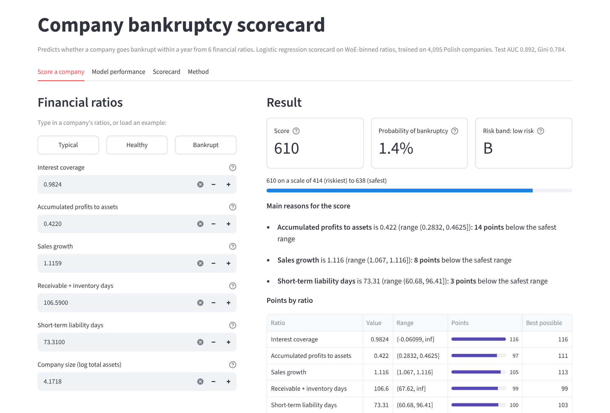

# Company Bankruptcy Scorecard

Predicts whether a company will go bankrupt within one year from its financial ratios, and turns the
prediction into a credit score that explains itself: every ratio adds points, and the app shows which
ratios pulled the score down.

**Live app:** _add your Streamlit link here after deploying_



## Results

Tested on 1,755 companies (122 bankruptcies) that neither model saw during training.

| Model | Ratios used | Test AUC (95% CI) | Gini | KS | Explains each decision |
|---|---|---|---|---|---|
| **Scorecard** (logistic regression on WoE bins) | 6 | **0.892** (0.865–0.916) | 0.784 | 0.671 | Yes, points per ratio |
| LightGBM benchmark | 64 | 0.951 (0.930–0.968) | 0.902 | 0.771 | No |

**The trade-off:** LightGBM ranks companies better by 0.059 AUC (95% CI 0.041 to 0.079). The scorecard
uses 6 ratios instead of 64 and gives a score anyone can trace back to its inputs, which is what banks
and credit bureaus need to explain and audit decisions.

**The risk bands separate well** (test set):

| Band | Probability of bankruptcy | Companies | Went bankrupt |
|---|---|---|---|
| A | under 1% | 400 | 0.0% |
| B | 1–3% | 769 | 1.4% |
| C | 3–8% | 243 | 5.8% |
| D | 8–20% | 155 | 18.1% |
| E | 20% and above | 188 | 36.7% |

Bands D and E hold 20% of the companies but 80% of the bankruptcies.

## The 6 ratios in the scorecard

Chosen automatically from 64 ratios (see [How it works](#how-it-works)), in the order they were added:

| Ratio | Formula | Riskier when |
|---|---|---|
| Interest coverage | operating profit / financial expenses | low, or not reported |
| Accumulated profits to assets | (equity − share capital) / total assets | low |
| Sales growth | sales this year / sales last year | sales are falling |
| Receivable + inventory days | receivable days + inventory days | short |
| Short-term liability days | short-term liabilities × 365 / sales | long |
| Company size | log of total assets | small |

## How it works

```
data/5year.arff ─► remove 60 duplicate rows ─► 70/30 stratified train/test split
                                                    │
        ┌───────────────────────────────────────────┴──────────────────┐
        ▼                                                              ▼
  WoE binning (train only)                                LightGBM on all 64 raw ratios
        ▼                                                              │
  Feature selection: IV ≥ 0.1 ─► correlation < 0.6 ─►                  │
  forward selection on 5-fold CV AUC                                   │
        ▼                                                              │
  Logistic regression on WoE values ─► scale to points                │
        ▼                                                              ▼
                        Evaluate both on the same test set
```

1. **Data.** 5,850 Polish companies after removing exact duplicates, each with 64 financial ratios.
   408 (7.0%) went bankrupt within a year.
2. **Split before anything is learned.** 70% train, 30% test, stratified so both have the same
   bankruptcy rate. Every step below is fitted on the training set only, so the test set stays unseen.
3. **WoE binning** ([src/woe.py](src/woe.py)). Each ratio is cut into up to 6 ranges. Each range must
   hold at least 5% of companies and 5 bankruptcies, and the bankruptcy rate must rise or fall steadily
   across ranges so the score is easy to explain. Each range gets a Weight of Evidence:
   `WoE = ln(share of healthy firms / share of bankrupt firms)`, so positive means safer than average.
   Binning also makes the model immune to the extreme outliers this dataset has.
4. **Feature selection** ([train.py](train.py)). Drop ratios with Information Value below 0.1. Many of
   the 64 ratios measure nearly the same thing (for example, several profit-to-assets ratios), so a ratio is
   dropped if its WoE correlates above 0.6 with a stronger one. The rest are added one at a time while
   5-fold cross-validated AUC improves by at least 0.002, and only if every coefficient keeps the
   expected sign.
5. **Logistic regression** on the WoE values of the 6 selected ratios.
6. **Scaling to points.** 600 points = odds of 50 healthy to 1 bankrupt, and every 20 points doubles the
   odds. Each range of each ratio gets a whole number of points; the score is their sum (414 to 638).
7. **Evaluation.** AUC, Gini (= 2 × AUC − 1) and KS on the test set, with 95% bootstrap confidence
   intervals because the test set has only 122 bankruptcies.

## Decisions worth knowing about

- **Duplicates removed before splitting.** 60 rows were exact copies. Left in, a company could sit in both
  train and test and inflate the test score.
- **Missing values that leak the answer.** Sales growth is missing for 24% of bankrupt firms but only 0.07%
  of healthy ones, which looks like a quirk of how the data was collected rather than real risk. Missing
  values get their own bin only if that bin holds at least 5% of companies; smaller missing groups are
  treated as average risk. Interest coverage keeps its missing bin (6% of companies, 30% went bankrupt).
- **The model is evaluated exactly as deployed.** Test metrics are computed from the rounded integer
  points the app uses, not from the raw model probabilities.

## Project structure

```
├── streamlit_app.py        the web app
├── train.py                training pipeline (writes everything in model/)
├── src/
│   ├── woe.py              WoE binning
│   ├── scorecard.py        scoring logic shared by the app and training
│   └── ratios.py           names and formulas of the 64 ratios
├── model/
│   ├── scorecard.json      the scorecard: bins, WoE and points for each ratio
│   ├── metrics.json        test results for both models
│   ├── iv_table.csv        IV of all 64 ratios and why each was kept or dropped
│   └── test_companies.csv  scored test-set companies, used by the app
├── data/5year.arff         raw data
├── requirements.txt        packages for the app
└── requirements-train.txt  extra packages for retraining
```

## Run it locally

```bash
python -m venv .venv
source .venv/bin/activate          # Windows: .venv\Scripts\activate
pip install -r requirements-train.txt

python train.py                    # retrains and rewrites model/ (about 15 seconds)
streamlit run streamlit_app.py     # opens the app at http://localhost:8501
```

The trained model is already in `model/`, so you can skip `python train.py` and only install
`requirements.txt` if you just want to run the app.

## Deploy on Streamlit Community Cloud (free)

1. Push this folder to a **public** GitHub repository.
2. Sign in at [share.streamlit.io](https://share.streamlit.io) with your GitHub account.
3. Click **Create app**, pick the repository and branch, and set the main file to `streamlit_app.py`.
4. In **Advanced settings**, choose Python 3.12.
5. Click **Deploy**. Copy the `.streamlit.app` link into the top of this README.

Free apps go to sleep after 12 hours without visitors, so open the link yourself before sharing it in an
interview.

## Limitations

- Probabilities reflect this dataset's 7% bankruptcy rate, far higher than in a typical loan book. A real
  deployment would recalibrate them to the portfolio's actual default rate.
- The data covers Polish companies (bankrupt firms 2000–2012, operating firms 2007–2013) and has no industry
  or macroeconomic information.
- One train/test split with 122 test bankruptcies; the confidence intervals show how much the metrics
  could move on a different sample.

## Data

Tomczak, S. (2016). *Polish Companies Bankruptcy* [Dataset]. UCI Machine Learning Repository.
https://doi.org/10.24432/C5F600. Licensed under CC BY 4.0.
